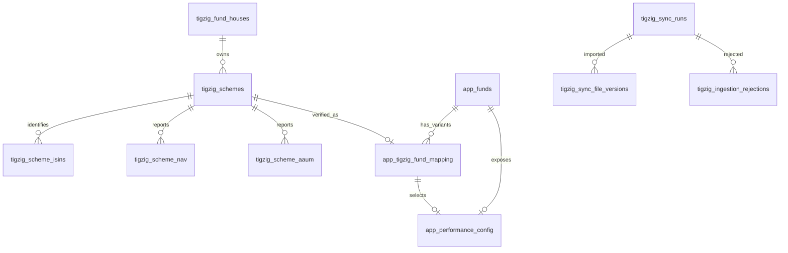

# VB-SIF database schema

All relations are in `VB-SIF.public`. The database retains the TIGZIG source and
`app_*` read-model tables and now implements the complete domain in `schema.sql`:
44 `sif_*` tables and five `vw_sif_*` views. Migration 0006 extends the five original
`sif_*` tables additively and creates the strategy, lineage, benchmark, factsheet,
portfolio, analytics, and optional user-feature layers without dropping source data.

## Provider identities and source records

`tigzig_fund_houses` uses an identity `fund_house_id` primary key and a unique
`original_amc_name`. Names preserve the provider's spelling and case without
normalization. Created and updated timestamps are timezone-aware.

`tigzig_schemes` uses `(source, scheme_code)` as its primary key. It references a
fund house and preserves names, category fields, plan/option, activity flags,
first/last NAV dates, source-reported latest NAV and AAUM fields, `txic_code`, and
nullable temporary fields. `source_metadata` preserves additional optional source
columns as JSON. Temporary codes are neither required nor unique. Optional status
values remain nullable; ingestion must interpret source values instead of inventing
defaults. Cached latest fields are source metadata snapshots, not derived analytics.

`tigzig_scheme_isins` references the composite scheme key. Its primary key permits
one PRIMARY and one SECONDARY identifier per scheme. The same ISIN cannot be assigned
to both types on one scheme or to two schemes within the same source. ISINs do not
create new schemes. Conflicting identifiers must later be quarantined for review.

`tigzig_scheme_nav` uses `(source, scheme_code, nav_date)` as its primary key and
references the composite scheme key. NAV is `NUMERIC(24,10)`, strictly positive,
and rejects NaN. Raw `upload_ts_raw` is authoritative text. The optional
`upload_ts_ist` is a timestamp **without** timezone, reserved for an explicitly
parsed IST wall-clock value. No timestamp parsing is implemented in this milestone.

`tigzig_scheme_aaum` uses `(source, scheme_code, quarter_end)` as its primary key
and references the composite scheme key. It stores quarter start/end and label,
lakhs as `NUMERIC(26,4)`, and crores as `NUMERIC(24,6)`. Values must be nonnegative
and finite, quarter start cannot follow quarter end, and
`aaum_cr = round(aaum_lakhs / 100, 6)`. Invalid or unresolved rows belong in the
rejection ledger during future import work, not in these source tables.

Financial precision is explicit. Later validation must reject source values that
would exceed or lose precision at these limits rather than silently truncating
or rounding accepted source values.

## Audit and file checkpoints

`tigzig_sync_runs` has a UUID primary key generated by PostgreSQL, trigger/job types,
start/completion timestamps, status, inspected manifest metadata, processed-file
array, five counters, error message, and execution duration in seconds. Terminal
states require completion time and duration; counts and duration cannot be negative.

`tigzig_sync_file_versions` holds one successful-import checkpoint per dataset
(`meta`, `nav`, `aaum`), with filename, SHA-256, manifest generation timestamp,
last check, successful import time, row count, and a foreign key to its last run.
An unimported checkpoint has no successful hash/run/time. After import those fields,
manifest timestamp, and row count must all be present. Future import code must
advance this checkpoint only when dependent data commits and must check that the
referenced run succeeded; the foreign key alone does not enforce run status.
Historical publication/run information resides in `tigzig_sync_runs`.

`tigzig_ingestion_rejections` has an identity primary key, run foreign key, dataset,
original record JSON, reason, resolution status, creation time, and optional resolution
time. Invalid input is retained for review. No rejection rows are populated yet.

## Canonical identity reservation

`app_funds` has an identity `fund_id`, canonical name, unique lowercase hyphenated
slug, status (`pending`, `active`, `inactive`), and timestamps.

`app_tigzig_fund_mapping` references both a canonical fund and a composite source
scheme. `(source, scheme_code)` is the primary key: one scheme can belong to only
one fund; many Direct/Regular and Growth/IDCW variants can belong to the same fund.
Every mapping requires verification method, nonempty JSON evidence, reviewer, and
verification time. There are no seeded funds or mappings. Future matching candidates
must be reviewed before entering this verified mapping relation.

`app_schema_migrations` records the platform migration version, filename, SHA-256,
and application time. Ledger infrastructure is versioned separately as bootstrap
0000; platform migrations 0001 through 0006 are checksum-tracked here.

## Relationships

Foreign keys use the default restrictive deletion behavior. No cascading deletion
of source history is configured.

## Index choices

Primary and unique keys supply indexes for scheme identity, per-scheme ordered
NAV/AAUM reads, identifier resolution, and unique fund slugs. PostgreSQL can scan
the composite NAV and AAUM indexes backwards to retrieve a scheme's latest row.

Ten additional indexes support fund-house/category filtering, date-wide NAV and
AAUM checks, recent runs, failed/interrupted runs (partial), version/run references,
run rejections, pending rejection review (partial), and fund-to-variant lookup.
There are no indexes on every field or on low-selectivity activity booleans.

Audit timestamps use `TIMESTAMPTZ`; event dates use `DATE`. TIGZIG/application
`updated_at` values remain managed by change-only UPSERTs. The new SIF domain uses
`sif_touch_updated_at` triggers on its mutable identity/history tables. Factsheet and
calculated-analytics tables are installed; their production loaders remain separate.

## Complete SIF domain

`sif_strategies` represents one investment strategy independently of Direct,
Regular, Growth, and IDCW scheme variants. Verified links in
`sif_strategy_scheme_links` must belong to the same AMC, enforced by a trigger.

`sif_ingestion_runs`, `sif_ingestion_files`, `sif_ingestion_rejections`, and
`sif_data_quality_issues` preserve source lineage and validation failures. The seeded
source registry distinguishes TIGZIG, official factsheets, benchmarks, and derived
calculations.

`sif_factsheet_documents` identifies immutable official PDFs by SHA-256. One document
may contain several `sif_factsheet_reports`; each report retains its full JSON in
`raw_extraction_json` and stores normalized managers, AUM, NAV, expense ratios,
holdings, allocations, indicators, risk bands, performance, IDCW, notes, external
links, field availability, and extension data in child tables. A partial unique index
permits only one primary report for a strategy and reporting month.

`sif_scheme_return_cache` and `sif_scheme_risk_cache` hold reproducible, versioned
derived values. Watchlist and comparison tables reference canonical scheme codes and
use cascading deletes only for user-owned collections.

## Milestone 6 application read models

`app_funds` contains 34 active canonical fund identities derived from exact fund-house
and provider fund-family keys. `app_tigzig_fund_mapping` contains 126 verified scheme
variants. Its evidence records the matcher version, exact AMC and family values,
normalized family/name values, declared plan/option, and source ISINs.

`app_tigzig_mapping_reviews` stores schemes that lack a required exact key or have
conflicting normalized family labels. Pending review rows cannot become mappings
without an explicit verified mapping write. The current source has no ambiguous rows.

`app_ticker_config` references the three-column verified mapping identity, preventing
a fund from selecting another fund's scheme. It holds visibility, display order,
selection evidence, and verifier metadata. The current 34 selections are Direct
Growth variants.

`app_performance_config` independently maps the externally observed IDs 1 through
34 to one verified Regular Growth variant per canonical fund. Its composite foreign
key prevents cross-fund scheme selection. Confidence, evidence, verifier, and time
are stored with each mapping; all 34 current mappings are high-confidence and have
at least one verified ISIN.

`app_external_identifiers` stores verified fund identifiers with source provenance;
the `(namespace, identifier_value)` pair is globally unique. The current 175 entries
are the PRIMARY and SECONDARY ISINs of mapped schemes.

`app_monthly_returns` and `app_performance_cache` reference source schemes and keep
calculated values separate from TIGZIG rows. Milestone 7 populates them with absolute
returns and selected-observation metadata. The ingestion transaction refreshes only
the distinct scheme keys whose NAV rows were inserted or corrected.

`app_benchmarks` declares benchmark identity, currency, source coverage, and PRICE/TRI
variant. `app_benchmark_history` stores positive decimal index levels keyed by benchmark
and date. A benchmark cannot be marked available without a source identifier and an
explicit PRICE/TRI declaration. The configured rows remain unavailable until audited
historical levels are loaded.
